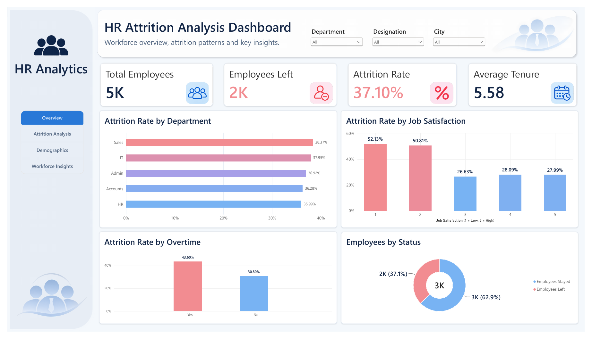
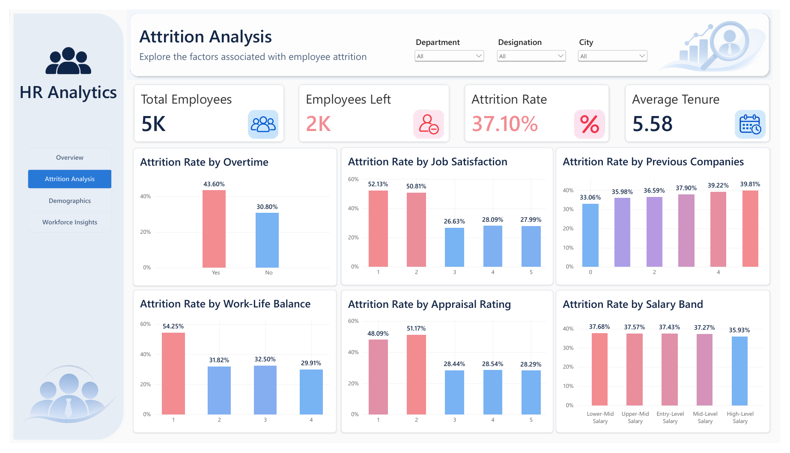
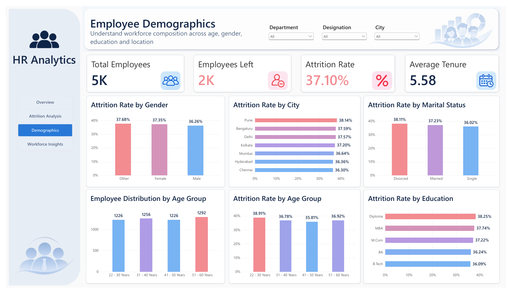
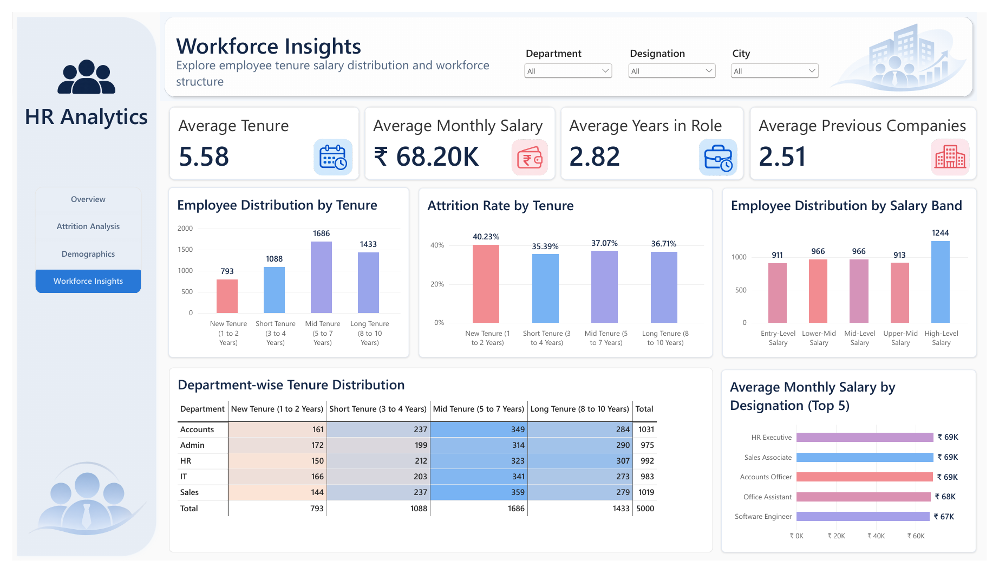
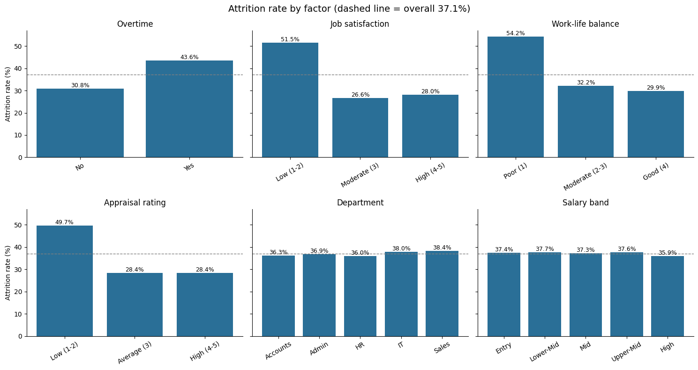
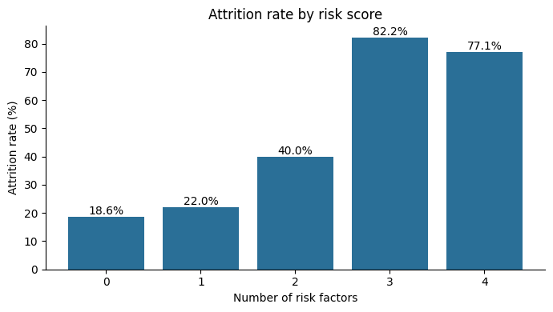

# HR Attrition & Workforce Analytics

An end-to-end analysis of 5,000 employee records (22 attributes, 37.1% attrition) to find which factors are associated with employees leaving. **Four factors separate who stays from who leaves: low job satisfaction, low appraisal rating, poor work-life balance and overtime.** Department, designation, gender, marital status, city and education show no meaningful difference. Employees with three or more of the four risk factors are 15.8% of the workforce but leave at 81.5%, against 18.6% for those with none.

**Tools:** MySQL · Python (pandas, matplotlib, SciPy) · Power BI

---

## Dashboard preview

**Page 1: Overview**



**Page 2: Attrition Analysis**



**Page 3: Employee Demographics**



**Page 4: Workforce Insights**



---

## Business question

An HR director has a limited retention budget. Which employees are most likely to leave, which factors matter, and which do not?

## Dataset

| | |
|---|---|
| Source | Public HR attrition dataset for an Indian workforce (synthetic) |
| Size | 5,000 employees, 22 columns |
| Target | `LeftCompany` (Yes / No): 1,855 left, 3,145 stayed |
| Coverage | 5 departments, 5 designations, 7 cities, salaries in ₹ (15,000–120,000 per month) |
| Quality | No nulls, no duplicate employee IDs, no duplicate rows |

## Approach

**1. MySQL: validation and attrition breakdowns** (`sql/hr_attrition.sql`)
- Null checks on all 22 columns, duplicate ID check and row counts.
- Attrition rate for every factor: department, designation, age, education, salary, tenure, years in role, previous companies, appraisal, training hours, overtime, job satisfaction, work-life balance, distance from home, leaves taken, city, gender and marital status.
- `CASE`-based banding of numeric columns, with `Other` fallback branches to confirm no rows fall outside the bands.
- Two-factor cross-tabs (for example overtime × job satisfaction, work-life balance × job satisfaction).
- A CTE that scores each employee from 0 to 4 on four risk factors, with a `RANK()` window function over the score groups.

**2. Python: statistical testing** (`python/hr_attrition_analysis.ipynb`)
- Repeated data-quality checks and built an `AttritionFlag` (1 = left) so the mean equals the attrition rate.
- A reusable `analyze_attrition()` function that works like a SQL `GROUP BY` for any column.
- `pd.cut` bands that match the SQL bands.
- **Chi-square test of independence** for 11 factors, with **Cramér's V** as the effect size.
- The 0–4 risk score, tested with chi-square.

**3. Power BI: interactive dashboard** (`powerbi/`)
- Four pages with page navigation and slicers for department, designation and city: Overview, Attrition Analysis, Demographics and Workforce Insights.
- KPI cards (total employees, employees left, attrition rate, average tenure) and attrition-rate charts for every factor.

## Key findings

**1. Overall:** 37.1% attrition (1,855 of 5,000 employees).

**2. Four factors are significantly associated with attrition:**

| Factor | Highest-risk group | Attrition | Comparison group | Attrition | Chi-square p | Cramér's V |
|---|---|---|---|---|---|---|
| Job satisfaction | Low (1–2) | 51.5% | High (4–5) | 28.0% | 1.3e-64 | 0.24 |
| Appraisal rating | Low (1–2) | 49.7% | High (4–5) | 28.4% | 1.4e-51 | 0.22 |
| Work-life balance | Poor (1) | 54.3% | Good (4) | 29.9% | 1.5e-46 | 0.21 |
| Overtime | Yes | 43.6% | No | 30.8% | 9.8e-21 | 0.13 |

For job satisfaction, appraisal and work-life balance the jump is at the bottom of the scale: attrition is roughly flat from the middle ratings to the top.

**3. Everything else is flat.** Attrition sits at 36–38% whatever the group:

| Factor | Attrition range | Chi-square p |
|---|---|---|
| Department | 36.0–38.4% | 0.76 |
| Designation | 35.3–38.5% | 0.63 |
| Gender | 36.3–37.7% | 0.68 |
| Marital status | 36.0–38.1% | 0.46 |
| City | 36.3–38.1% | 0.99 |
| Education | 36.1–38.3% | 0.83 |

Salary band, years in role, training hours, distance from home and leaves taken are also flat (35–38%), apart from two very small groups (82 employees with no training and 169 with no leave) at 40%.

**4. Previous companies is real but weak.** Attrition rises from 33.1% (no previous employers) to 39.8% (five), p = 0.014, but Cramér's V is only 0.046, about five times weaker than the four main factors.

**5. Combining the four factors gives a clear high-risk group.** One point for each: overtime, job satisfaction 1–2, work-life balance 1, appraisal 1–2.

| Risk factors | Employees | Attrition |
|---|---|---|
| 0 | 665 | 18.6% |
| 1 | 1,831 | 22.0% |
| 2 | 1,714 | 40.0% |
| 3 | 681 | 82.2% |
| 4 | 109 | 77.1% |

Attrition stays near 20% with 0–1 factors, doubles at 2, and reaches about 80% at 3 or more (p < 0.001). The group with all 4 factors is small (109 people), so its rate is noisy and slightly lower than the 3-factor group. **Employees with 3+ factors: 790 people (15.8%) with 81.5% attrition.**





## Recommendation

- **Focus the retention budget on the roughly 790 employees with three or more risk factors.** They are about 16% of the workforce but account for 644 of the 1,855 leavers.
- **Address the underlying factors,** starting with work-life balance and overtime, which are the ones HR can change directly, and look at why low-rated employees leave at 50%.
- **Don't target retention by department, city, gender, education or salary band.** None of them separates leavers from stayers.
- **Track the risk score as a standing KPI,** so HR can see how many employees are in the high-risk group each quarter.

## Data quality and limitations

- **The data looks synthetic.** Department and designation are unrelated (for example, "Software Engineer" appears in HR and Accounts), and almost every factor is uniform. The project demonstrates method and honest reporting, not a real employer's results.
- **Association, not cause.** Chi-square tests show that a factor and attrition move together. They do not show that one causes the other. Each test looks at one factor at a time.
- **The risk score is a screening tool, not a prediction model.** It uses equal weights and hand-picked cut-offs.
- **No multiple-testing correction.** I tested 11 factors without a correction such as Holm. This would not change the four main findings (p-values near zero) but would likely make previous companies non-significant.
- **No leaving date or reason.** The dataset has only a Yes/No flag, so there is no trend over time or reason-for-leaving analysis.
- **Rating charts differ slightly between tools.** SQL and Python use bands (for example, job satisfaction "Low" = 1–2 at 51.5%), while the dashboard shows each rating from 1 to 5 (rating 1 at 52.1%, rating 2 at 50.8%). Both are consistent.
- **`Gender` has three categories,** including "Other" (about a third of employees).

## Repository structure

```
hr-attrition-workforce-analytics/
├── README.md
├── images/
│   ├── dashboard_overview.png
│   ├── dashboard_attrition_analysis.png
│   ├── dashboard_demographics.png
│   ├── dashboard_workforce_insights.png
│   ├── attrition_by_factor.png
│   └── attrition_by_risk_score.png
├── Dataset/
│   └── HR_Attrition_Indian_Dataset.csv
├── SQL/
│   └── hr_attrition.sql
├── Python/
│   └── hr_attrition_analysis.ipynb
└── PowerBi/
    ├── HR_Attrition_Analysis_Dashboard.pbix
    └── HR_Attrition_Analysis_Dashboard.pdf
```

## How to reproduce

1. **MySQL:** import `data/HR_Attrition_Indian_Dataset.csv` into a table named `hr_attrition_indian_dataset`, then run `sql/hr_attrition.sql`.
2. **Python:** open the notebook in Jupyter or Google Colab, place the CSV in the same folder (or update the path in the load cell) and run all cells.
3. **Power BI:** open the `.pbix` file in Power BI Desktop. It reads the CSV, so re-point the data source if the file path differs.

## What I'd do next

- **Fit a logistic regression** to test the four factors together, to see which ones matter after accounting for the others.
- **Apply a multiple-testing correction** (Holm) to the 11 chi-square tests.
- **Repeat the analysis on real data** that includes leaving dates and exit reasons, to add trend and reason analysis.

## Skills demonstrated

Data validation · SQL aggregation, `CASE` banding, CTEs, window functions and cross-tabs · pandas (`groupby`, `pd.cut`, `crosstab`) · Hypothesis testing (chi-square, Cramér's V) · Dashboard design with DAX, slicers and page navigation · Reporting null results and limitations honestly · Turning findings into business recommendations

## Author

**Mihir Kavde**: Aspiring Data Analyst
[LinkedIn](https://www.linkedin.com/in/mihir-kavde-923561308/) · [GitHub](https://github.com/MihirKavde) · mihirkavde@gmail.com
